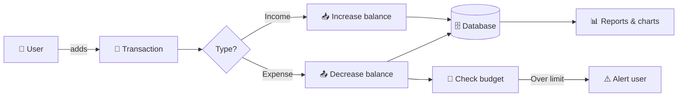
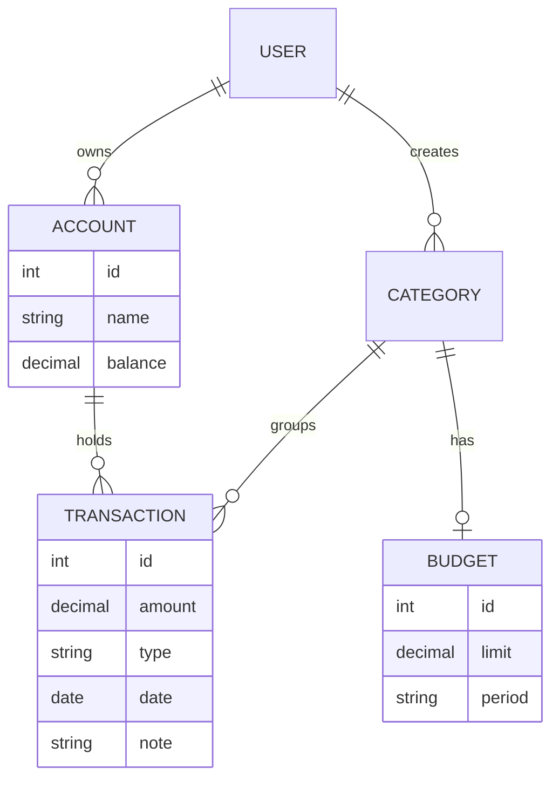

<div align="center">

# 💰 Money Manager

**Track income, control expenses, and hit your savings goals — all in one place.**


[Features](#-features) •
[Demo](#-demo) •
[Getting Started](#-getting-started) •
[How It Works](#-how-it-works) •
[Roadmap](#-roadmap) •
[FAQ](#-faq) •
[Contributing](#-contributing)

</div>

---

## ✨ Features

|     | Feature                    | Description                                               |
| --- | -------------------------- | --------------------------------------------------------- |
| 📥  | **Income tracking**        | Log salary, freelance work and other income sources       |
| 📤  | **Expense tracking**       | Record spending and sort it into categories               |
| 🗂️  | **Categories**             | Food, transport, bills, shopping and your own custom ones |
| 🎯  | **Budgets**                | Set monthly limits per category and get warned when close |
| 🏦  | **Multiple accounts**      | Cash, bank, e-wallet and credit card in one view          |
| 📊  | **Reports & charts**       | Daily, monthly and yearly summaries                       |
| 🔁  | **Recurring transactions** | Rent, subscriptions and bills added automatically         |
| 📤  | **Export**                 | Download your data as CSV / Excel                         |
| 🌙  | **Dark mode**              | Easy on the eyes at night                                 |

---

## 🎬 Demo

> Replace the images below with your own screenshots or GIFs (put them in a `docs/` folder).

<details open>
<summary><b>📱 Dashboard</b></summary>
<br>


</details>

<details>
<summary><b>➕ Add Transaction</b></summary>
<br>


</details>

<details>
<summary><b>📊 Reports</b></summary>
<br>


</details>

🔗 **Live demo:** https://your-demo-link.com

---

## 🚀 Getting Started

### Prerequisites

- [ ] Git installed
- [ ] Runtime installed (e.g. Node.js 20+, PHP 8.2+, Flutter 3+, Python 3.11+)
- [ ] Database (e.g. MySQL / PostgreSQL / SQLite)

### Installation

```bash
git clone https://github.com/YOUR_USERNAME/YOUR_REPO.git
```

```bash
cd YOUR_REPO
```

<details>
<summary><b>🟢 Node.js / React</b></summary>

```bash
npm install
cp .env.example .env
npm run dev
```

</details>

<details>
<summary><b>🐘 Laravel / PHP</b></summary>

```bash
composer install
cp .env.example .env
php artisan key:generate
php artisan migrate --seed
php artisan serve
```

</details>

<details>
<summary><b>🐦 Flutter</b></summary>

```bash
flutter pub get
flutter run
```

</details>

<details>
<summary><b>🐍 Python / Django</b></summary>

```bash
pip install -r requirements.txt
python manage.py migrate
python manage.py runserver
```

</details>

> 💡 Delete the stacks you don't use and keep only yours.

### Environment variables

<details>
<summary>Show <code>.env</code> example</summary>

```env
APP_NAME="Money Manager"
APP_URL=http://localhost:3000
DB_CONNECTION=mysql
DB_HOST=127.0.0.1
DB_PORT=3306
DB_DATABASE=money_manager
DB_USERNAME=root
DB_PASSWORD=
CURRENCY=MYR
```

</details>

---

## 🧠 How It Works



### Data model



---

## 🛠️ Tech Stack

| Layer    | Technology                        |
| -------- | --------------------------------- |
| Frontend | _e.g. React, Vue, Blade, Flutter_ |
| Backend  | _e.g. Laravel, Express, Django_   |
| Database | _e.g. MySQL, PostgreSQL, SQLite_  |
| Charts   | _e.g. Chart.js, Recharts_         |
| Hosting  | _e.g. Vercel, Netlify, Render_    |

---

## 📁 Project Structure

<details>
<summary>Click to expand</summary>

```
money-manager/
├── docs/              # Screenshots for this README
├── src/
│   ├── components/    # UI components
│   ├── pages/         # Dashboard, Transactions, Reports, Settings
│   ├── services/      # API / database logic
│   └── utils/         # Currency formatting, date helpers
├── tests/
├── .env.example
└── README.md
```

</details>

---

## 🗺️ Roadmap

- [x] Add income & expense
- [x] Categories
- [x] Monthly report
- [ ] Budget alerts
- [ ] Recurring transactions
- [ ] Multi-currency support
- [ ] Receipt photo upload
- [ ] Mobile app

---

## ❓ FAQ

<details>
<summary><b>Is my financial data safe?</b></summary>

Your data is stored in your own database. Nothing is shared with third parties.

</details>

<details>
<summary><b>Can I change the currency?</b></summary>

Yes — set `CURRENCY` in your `.env` file (e.g. `MYR`, `USD`, `EUR`).

</details>

<details>
<summary><b>Can I import data from another app?</b></summary>

CSV import is on the [roadmap](#️-roadmap).

</details>

---

## 🤝 Contributing

1. Fork the repo
2. Create a branch: `git checkout -b feature/amazing-feature`
3. Commit: `git commit -m "Add amazing feature"`
4. Push: `git push origin feature/amazing-feature`
5. Open a Pull Request 🎉

Found a bug? [Open an issue](https://github.com/YOUR_USERNAME/YOUR_REPO/issues).

---

## 📄 License

Distributed under the MIT License. See [`LICENSE`](LICENSE) for details.

---

<div align="center">

Made with ❤️ by [YOUR_NAME](https://github.com/YOUR_USERNAME)

⭐ **If this project helped you, give it a star!** ⭐

[⬆ Back to top](#-money-manager)

</div>
